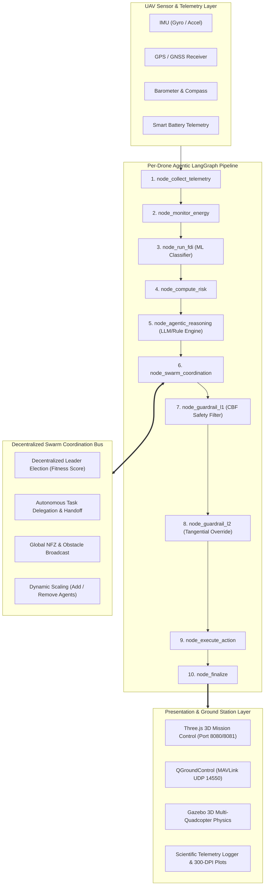

# AUTONOMOUS UAV SWARM: MULTI-AGENT RESILIENT FDI & SAFETY ARCHITECTURE
## Complete System Technical Documentation & Project Overview

---

### Executive Summary

Modern multi-UAV autonomous systems operating in contested, dynamic, or safety-critical airspaces face concurrent threats: sensor anomalies (GPS denial, IMU bias, barometer drift, compass heading glitches), rapid battery depletion, physical obstacle incursions, and strict No-Fly Zone (NFZ) airspace constraints. 

This project delivers an **end-to-end, decentralized, fault-tolerant autonomous UAV swarm control platform** integrating:
1. **Machine Learning-Based Fault Detection & Isolation (FDI)** via optimized ExtraTrees ensemble models.
2. **Multi-Agent Agentic Reasoning** engineered with **LangGraph** finite-state computational graphs per drone.
3. **Rigorous Dual-Layer Safety Guardrails** using **Control Barrier Functions (CBF)** to mathematically guarantee zero NFZ incursions and collision avoidance.
4. **Decentralized Swarm Coordination & Consensus** enabling autonomous leader re-election, live waypoint task delegation, and horizontal scaling.
5. **Interactive 3D Web Ground Control Station (GCS)** powered by **Three.js**, live WebSockets, and real-time 3D flight trajectory visualization.
6. **PX4 SITL, Gazebo, and QGroundControl (QGC) Hardware-in-the-Loop (HIL)** readiness via MAVLink.

---

## 1. High-Level System Architecture



---

## 2. Core Functional Modules

### 2.1. Machine Learning Fault Detection & Isolation (FDI)
- **Model Type**: ExtraTrees (Extremely Randomized Trees) Classifier.
- **Trained Artifact**: `uav_fdi_extratrees_model.joblib`.
- **Input Dimensions**: Multi-axial raw sensor readings and statistical temporal features:
  - Angular velocities ($\omega_x, \omega_y, \omega_z$)
  - Linear accelerations ($a_x, a_y, a_z$)
  - Barometric pressure & vertical climb rates
  - GPS satellite count, HDOP, fix status, velocity variances
  - Magnetic heading variance and compass field strength
- **Classified Failure Modes**:
  1. `No Failure` (Nominal flight state)
  2. `GPS Failure` (Satellite drop, spoofing, multipath noise)
  3. `Gyroscope Failure` (Angular rate saturation, stuck bias)
  4. `Accelerometer Failure` (Scaling error, thermal drift)
  5. `Barometer Failure` (Pressure altitude jumps)
  6. `Compass Failure` (Electromagnetic distortion, heading lock)
  7. `Battery Depletion` (Voltage sag below critical safety thresholds: 14% warning, 8% critical)

### 2.2. Dual-Layer Control Barrier Functions (CBF)
To guarantee safety without relying solely on heuristic route replanning, control actions are passed through mathematical Control Barrier Functions:
- **Layer 1 (L1 - Radial Safety Barrier)**:
  Let the circular No-Fly Zone have center $(x_0, y_0)$ and radius $R_{nfz}$. The safety barrier certificate is formulated as:
  $$h(x, y) = (x - x_0)^2 + (y - y_0)^2 - (R_{nfz} + D_{margin})^2 \ge 0$$
  When $h(x, y) \ge 0$, the UAV is strictly outside the protected airspace.
- **Layer 2 (L2 - Tangential Velocity Projection Override)**:
  If an aerodynamic disturbance or aggressive trajectory causes $\dot{h}(x) + \alpha(h(x)) < 0$, the controller instantly projects the desired velocity vector onto the tangent of the barrier boundary:
  $$v_{safe} = v_{des} - \frac{\nabla h \cdot v_{des}}{\|\nabla h\|^2} \nabla h + v_{tangent}$$
  This converts head-on incursions into smooth, boundary-following orbital maneuvers with **zero boundary breaches**.

### 2.3. Decentralized Swarm Leader Election
The swarm operates without a vulnerable centralized ground master. If the current leader (UAV-1) suffers sensor failure or battery depletion, an automated distributed election triggers:
$$\text{Fitness Score } F_i = 0.4 \cdot B_i + 0.3 \cdot (1 - R_i) + 0.2 \cdot G_i + 0.1 \cdot S_i$$
Where:
- $B_i \in [0, 1]$: Normalized remaining battery capacity.
- $R_i \in [0, 1]$: Composite operational risk score.
- $G_i \in \{0, 1\}$: Binary GPS health validity.
- $S_i \in \{0.5, 1.0\}$: Primary sensor array health.

The highest-scoring healthy agent is autonomously elected Swarm Master, immediately inheriting command broadcasting and MAVLink telemetry reporting.

### 2.4. Autonomous Task Delegation & Waypoint Handoff
When an agent experiences critical degradation (e.g., Gyroscope failure or Critical Battery):
1. The faulted drone cancels its assigned waypoint queue and switches to `FAILSAFE_LAND` or `RETURN_TO_HOME`.
2. It publishes an uncompleted task payload to the `SwarmBus`.
3. The peer drone with the lowest workload and highest battery capacity accepts the handoff, dynamically expanding its patrol sector without human intervention.

---

## 3. Telemetry & Master System Report Data Schema

Every 2 simulation ticks (or immediately upon task completion / fault injection), the swarm exports an atomic JSON snapshot to `master_system_report.json` and appends a row to `flight_telemetry_log.csv`.

```json
{
  "report_type": "AUTONOMOUS_SWARM_SYSTEM_TELEMETRY",
  "timestamp_epoch": 1792228202.66,
  "timestamp_iso": "2026-10-17T09:10:02Z",
  "tick": 42,
  "swarm_master": {
    "uav_id": "UAV-1",
    "role": "👑 Swarm Leader",
    "position": [15.2, 8.4, 12.0],
    "battery_pct": 91.4,
    "health": "No Failure"
  },
  "swarm_health_summary": {
    "total_agents": 4,
    "online_agents": 4,
    "grounded_agents": 0,
    "active_faults_count": 0,
    "system_status": "NOMINAL",
    "simulation_backend": "STANDALONE_SIM"
  },
  "swarm_mission_progress": {
    "total_tasks_completed": 14,
    "total_tasks_assigned": 22,
    "progress_pct": 63.6,
    "mission_status": "IN_PROGRESS"
  },
  "agents_telemetry": [
    {
      "uav_id": "UAV-1",
      "role": "👑 Swarm Leader",
      "is_leader": true,
      "position": {"x": 15.2, "y": 8.4, "z": 12.0},
      "velocity": {"vx": 1.4, "vy": 0.8, "vz": 0.0},
      "battery_pct": 91.4,
      "energy_alert": "NORMAL",
      "fdi_fault": "No Failure",
      "decision_proposal": "NOMINAL_CONTINUE",
      "action": "NOMINAL_CONTINUE",
      "current_waypoint_idx": 2,
      "tasks_completed": 4,
      "total_tasks": 6,
      "nfz_distance_m": 32.4,
      "nfz_violation": false,
      "link_quality_pct": 100.0,
      "comms_latency_ms": 0.5
    }
  ]
}
```

---

## 4. Hardware and Simulation Integration

1. **PX4 Autopilot SITL**: Connects via MAVLink UDP port 14550 / 14540.
2. **Gazebo Simulator**: Real-time multicopter model pose injection via `gz topic -p` with automated Gazebo world discovery (`_get_gazebo_world()`).
3. **QGroundControl (QGC)**: Live MAVLink STATUSTEXT broadcasts relaying master election updates, waypoint milestones, and FDI fault warnings directly to the pilot HUD.

---
*Document Version: 2.4.0 — Maintained by UAV Swarm Autonomous Systems Engineering Team.*
